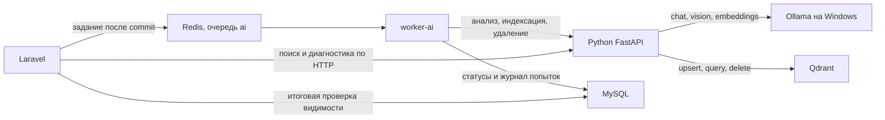

# Этап 4.1. Аудит AI-инфраструктуры Library Stroll

Снимок локального Docker-окружения Windows от 21 ноября 2026 г., около 13:36 по времени пользователя. Ветка `docker`, исходная ревизия `b2f8554dda17`, Compose-проект `library-stroll-docker`.

## 1. Краткое заключение

**AI-контур в текущем окружении работает частично. Этап 4.1 остаётся открытым.** Laravel обращается к FastAPI и Redis, FastAPI читает целевую коллекцию Qdrant. FastAPI также получает HTTP 200 от Ollama, но каталог моделей пуст и `ai-api` отмечен как `unhealthy`. Обработка изображений, свежая генерация эмбеддингов и сквозное выполнение задания текущим worker требуют отдельной проверки.

В Qdrant **20 точек с векторами размерности 1024**. Все 20 идентификаторов совпадают с `qdrant_point_id` соответствующих записей MySQL. При этом MySQL показывает **0 `indexed` и 21 `failed`**. В журнале есть 24 успешных и 116 неуспешных попыток `analyze_and_index`. Это история попыток, включая повторы, а не количество уникальных работ. Пустой каталог Ollama — текущая причина ошибки готовности. Последние сохранённые ошибки у всех 21 работ классифицированы как HTTP 502 с признаком ошибки соединения. Точную причину прежних сбоев и порядок переходов каждого статуса этот снимок не устанавливает.

Диагностика читала HTTP-состояние, счётчики Redis, строки MySQL и метаданные существующих точек. Тестовые записи PHP были изолированы в SQLite, Python использовал моки и Qdrant SDK в памяти. Команды импорта, исследования датасета, миграции, ручная постановка заданий, `smoke` и `ai:reindex-all` не выполнялись. Датасет, manifest и рабочие коллекции не менялись диагностикой.

## 2. Текущая архитектура



`worker-default` обслуживает очередь `default`, в том числе медиа-задачи. Scheduler каждые 30 минут запускает `ai:reconcile --limit=25`, если AI включён. Поиск обращается к FastAPI напрямую. Laravel объединяет лексические и семантические кандидаты через RRF, затем перечитывает доступные работы из MySQL. При ошибке семантической ветки остаётся лексическая выдача. Для похожих работ предусмотрен поиск по тегам. [Расписание](../../routes/console.php#L11), [гибридный поиск](../../app/Services/Search/HybridSearchService.php#L23), [похожие работы](../../app/Http/Controllers/ArtworkController.php#L79).

## 3. Состояние компонентов

| Компонент | Состояние | Способ проверки | Результат |
|---|---|---|---|
| Docker Desktop | Доступен | Docker Engine, Compose `status` | Engine `29.6.2`, проект запущен |
| Laravel App | `healthy` | Compose, Artisan, bootstrap приложения | Laravel `13.39.0`, PHP `8.5.12`, конфигурация без кеша. `ai:health` получил `degraded`, код 1 ожидаем для этого ответа |
| Web / Nginx | `healthy` | Compose, `GET /up` | HTTP 200 на `127.0.0.1:8088` |
| MySQL | `healthy` | Compose, `ai:status`, агрегаты Laravel | 512 опубликованных. `pending` 0, `processing` 0, `indexed` 0, `failed` 21, `stale` 0 |
| Redis | `healthy` | Compose, `PING`, штатный Laravel-драйвер | `PONG`, обе очереди доступны. `pending`, `reserved`, `delayed` равны нулю для каждой очереди в момент проверки |
| `worker-default` | Запущен | Compose, команда процесса | `queue:work redis --queue=default`. Контрольное задание в живую очередь не ставилось |
| `worker-ai` | Запущен | Compose, команда процесса и настройки очереди | `queue:work redis --queue=ai`. Текущее сквозное выполнение не проверялось |
| Scheduler | Запущен | Compose, `schedule:list` | `schedule:work`, `ai:reconcile --limit=25` есть в расписании. Ручного запуска не было |
| Python `ai-api` | HTTP доступен, `unhealthy` | Compose, `/health`, защищённый `/api/v1/diagnostics` | Python `3.12.16`. Qdrant `ok`, Ollama без моделей. Диагностика с рабочим ключом через Laravel успешна |
| Qdrant | Доступен, коллекция `green` | Штатная диагностика, `count` и `scroll` | Сервер и SDK `1.18.0`. 20 точек с векторами, `Cosine`, 1024, `indexed_vectors_count=0` |
| Ollama Windows | HTTP доступен, модели отсутствуют | `/api/version`, `/api/tags` с Windows и из `ai-api`, `/api/ps` | Версия `0.40.10`. Обе проверки каталога показали 0 моделей. Загруженных моделей 0 |
| Ollama Docker | Режим не активен | `docker/.env`, список Compose и файлы override | Текущий режим `host`. Варианты `docker` и `gpu` изучены по коду |

## 4. Найденные проблемы

### Критические

Критической утраты данных или подтверждённой утечки в проверенном окружении не обнаружено.

### Высокие

- **Ollama не готов к анализу и embeddings.** Адрес и соединение работают, все три требуемых тега отсутствуют в каталоге сервера. Нужно определить хранилище, используемое действующим Windows-процессом, и вернуть доступ к нужным моделям. Документация от 24 октября описывает прежнее наличие моделей в `B:\models`. Оно не подтверждает состояние текущего процесса. [Проверка Ollama](../../ai-service/app/clients/ollama.py#L66), [исторический запуск](docker.md#проверено-24102026).
- **Reconcile расходует ресурсы на неизменённые работы и может исчерпать восстановление.** Успешно индексированные записи старше 24 часов принудительно переотправляются раньше этапа обработки `failed`. У текущих 21 `failed` накоплено 5–7 запусков обработки. Для ветки `failed` сейчас пригодно 0 записей. Восстановление моделей само по себе их не вернёт. На следующем этапе привязать переиндексацию к ревизии, версии модели или отсутствию точки и ввести осознанное возобновление после сбоя зависимости. [Критерии reconcile](../../app/Console/Commands/AiReconcileCommand.php#L37), [накопление попыток](../../app/Jobs/AnalyzeAndIndexArtworkJob.php#L91).
- **Статусы и доступ в Qdrant могут разойтись с MySQL.** Текущие 20 точек совпадают с MySQL по ID при статусе `failed`. По коду `upsert` и фиксация SQL раздельны. Удаление публикации завершает транзакцию раньше enqueue удаления. Сбой после commit, отключённый AI или исчерпанные попытки могут оставить точку. После изменения видимости старый payload может оставаться доступным в прямом AI API для клиента с ключом. Qdrant не знает о блокировке автора, а источник `similar` выбирается по ID без проверки флагов видимости. Публичные Laravel-выдачи повторно проверяют MySQL. В снимке все 20 точек соответствуют видимым работам. Безопасное исправление — добавить повторяемое удаление или обновление payload при изменении доступа, сверку по ревизии и ограничить прямой API доверенными клиентами. [Запись и повторное чтение](../../app/Jobs/AnalyzeAndIndexArtworkJob.php#L170), [удаление](../../app/Actions/Artwork/DeleteArtwork.php#L14), [similar и фильтр](../../ai-service/app/clients/qdrant.py#L149), [SQL-проверка](../../app/Models/Artwork.php#L28).
- **Смена embedding-модели может дать несовместимый индекс при здоровом `/health`.** В существующей коллекции проверяется только размерность при инициализации и upsert. Название модели отсутствует в payload и хеше работы. Для другой модели той же размерности возможно смешение векторов. При другой размерности upsert отклоняется, однако проверка здоровья видит существующую коллекцию. Перед записью подтвердить происхождение действующих векторов и согласовать версию коллекции по модели, размерности и метрике. [Qdrant health и проверка размерности](../../ai-service/app/clients/qdrant.py#L37), [payload](../../ai-service/app/services/artwork_service.py#L82), [SHA256 работы](../../app/Services/AiService/ArtworkIndexingService.php#L11).

### Средние

- **Защита FastAPI зависит от заполненного ключа.** Сейчас `/api/v1/diagnostics` вернул 401 без ключа и с заведомо неверным ключом. При пустом ключе `verify_api_key` пропускает запросы, включая запись и удаление. `/health` и `/ready` открыты, причём `/ready` при доступном Ollama и недоступной коллекции может вызвать inference для определения размерности и создать коллекцию. Ужесточить отказ запуска или запросов при пустом ключе в Docker и сделать readiness проверкой чтения. [Авторизация](../../ai-service/app/api/dependencies.py#L9), [readiness](../../ai-service/app/api/routes.py#L99).
- **Qdrant без ключа доступен локальным процессам и контейнерам внутренней сети проекта.** Docker публикует порт только на `127.0.0.1:6335`. В проверке чтение без ключа прошло. Если доступ с Windows не требуется, убрать публикацию. Для более широкого развёртывания ограничить сеть и настроить авторизацию Qdrant. [Compose](../../compose.yaml#L111), [клиент Qdrant](../../ai-service/app/clients/qdrant.py#L21).
- **Бюджет HTTP не полностью согласован с бюджетом задания.** PHP ждёт один index-запрос до 180 с. На стороне FastAPI embedding может ждать до 180 с, после него следуют обращения к Qdrant с таймаутом 30 с. Laravel выполняет до двух попыток для index и delete с паузой 500 мс и одиночный запрос для analyze. Повтор index-запроса после клиентского таймаута может дублировать inference с тем же ID точки. При аварийном завершении `failed()` пишет лог, но оставляет запись `processing` и незакрытый run до дальнейшей обработки. Выравнять дедлайны и явно завершать просроченные попытки. [PHP-клиент](../../app/Services/AiService/HttpAiServiceClient.php#L169), [Python index](../../ai-service/app/services/artwork_service.py#L73), [обработка завершения job](../../app/Jobs/AnalyzeAndIndexArtworkJob.php#L230).
- **Сырые ошибки могут раскрывать детали запроса и окружения.** Штатные Laravel-логи операций пишут ID, а ключ передаётся заголовком. Поиск точного значения текущего AI-ключа в последних доступных строках `app`, `ai-api`, `scheduler` (по 250), `worker-ai` и `worker-default` (по 7) дал 0 совпадений. Выборка ограничена указанными журналами и текущим ключом. В ветках ошибок FastAPI возвращает `str(exc)` и пишет traceback, Laravel сохраняет сообщения исключений и показывает `last_error` через `ai:status` по умолчанию. Мониторинг маскирует ключ и часть чувствительных фрагментов при отображении. Стоит ограничить ответы типом ошибки и ID запроса, а сообщения санитизировать перед сохранением и логированием. [Ошибки FastAPI](../../ai-service/app/api/routes.py#L117), [журнал Laravel](../../app/Jobs/AnalyzeAndIndexArtworkJob.php#L230), [CLI](../../app/Console/Commands/AiStatusCommand.php#L21), [маскирование в мониторинге](../../app/Services/AiService/AiMonitoringService.php#L74).

### Низкие

- **Статус readiness не объясняет причину в деталях.** `/health` сводит пустой каталог, пропущенный тег и сбой соединения к `ollama=unavailable`. `AiDiagnosticsClient` показывает установленность по ролям, но проверка Qdrant помечает `degraded` только для `red` и не валидирует схему коллекции. Для диагностики использовать оба результата, а в health добавить раздельное состояние транспорта, моделей и совместимости. [HTTP-диагностика](../../ai-service/app/api/routes.py#L43).
- **Счётчик `ai:reconcile` завышает число заданий при пропусках.** Команда расходует лимит после вызова `dispatchForMeta()` независимо от результата и не задаёт стабильный порядок выборки. `dispatch()` выставляет `pending` до фактической поставки в Redis и может вернуть `true`, даже если Laravel подавил дубликат. В отчёте команды стоит различать кандидата, enqueue и пропуск. [Reconcile](../../app/Console/Commands/AiReconcileCommand.php#L37), [dispatch](../../app/Services/AiService/ArtworkIndexingService.php#L27).
- **Инструкция по AI-индексации описывает отдельный локальный запуск.** В ней упомянуты PHP 8.2, корневой `.env` и собственный процесс Python. Проверенный проект использует PHP 8.5 и `docker/.env`. Стоит обозначить режимы в инструкции явным заголовком, чтобы команды локального запуска не использовались для Docker. [Инструкция AI](ai-indexing-setup.md), [PHP Dockerfile](../../docker/php/Dockerfile#L2).

## 5. Проверка конфигурации

Для Docker используется `docker/.env`. `scripts/docker.ps1` читает из него режим и передаёт файл в Compose. `compose.yaml` добавляет значения через `environment`, поэтому часть обязательных параметров отсутствует в самом `.env`, но присутствует в контейнерах. `.dockerignore` исключает рабочие `.env` из контекста сборки. [Обёртка](../../scripts/docker.ps1#L73), [Compose](../../compose.yaml#L3), [шаблон окружения](../../docker/.env.example), [исключения](../../.dockerignore).

| Настройка | Наблюдение и результат |
|---|---|
| `AI_SERVICE_ENABLED` | `true` в файле и в Laravel |
| `AI_SERVICE_URL` | Compose задаёт `http://ai-api:8001`. Runtime совпал, `/health` и авторизованная диагностика ответили |
| `AI_SERVICE_API_KEY` | Заполнен в `docker/.env`, Laravel и Python. Запрос штатного клиента авторизован. Значения не выводились |
| `AI_PROCESSING_QUEUE`, `QUEUE_CONNECTION` | `ai`, `redis`. Имена очередей `default` и `ai` разделены, оба набора счётчиков доступны |
| `OLLAMA_BASE_URL` | `http://host.docker.internal:11434` внутри `ai-api`. `/api/tags` вернул 200, список пуст |
| `OLLAMA_CHAT_MODEL` | `qwen3:8b`, текстовый анализ. Тег отсутствует в действующем Ollama |
| `OLLAMA_VISION_MODEL` | `qwen3-vl:4b`, анализ изображения. Тег отсутствует |
| `OLLAMA_EMBEDDING_MODEL` | `qwen3-embedding:0.6b`, индексация и семантический поиск. Тег отсутствует |
| `QDRANT_URL`, `QDRANT_COLLECTION` | `http://qdrant:6333`, `librarystroll_artworks`. Целевая коллекция доступна из FastAPI |
| `QDRANT_API_KEY` | Ключ отсутствует в Python. Порт Qdrant опубликован только на loopback. AI API также опубликован только на loopback `127.0.0.1:8002` |
| Прочие обязательные секреты | `APP_KEY`, `DB_PASSWORD`, `MYSQL_ROOT_PASSWORD` заполнены в Docker-файле. `APP_DEBUG=true`, окружение предназначено для локальной работы |

В CPU override Ollama использует внутренний адрес `http://ollama:11434`, отдельный том моделей и одноразовый `ollama-models` для загрузки тегов. GPU override резервирует NVIDIA GPU. Текущий режим `host` не выполняет контейнерную загрузку моделей. [Host и внутренний API](../../compose.yaml#L194), [CPU override](../../compose.ollama.yaml), [GPU override](../../compose.ollama-gpu.yaml).

**Ollama по коду.** Job передаёт thumbnail при его наличии, либо доступный оригинал для изображения. Без изображения используется text. С изображением Vision пытается вернуть структурированный JSON. При `httpx.HTTPError` (включая timeout и ошибочный HTTP-статус) или `ValueError` (включая невалидный JSON или схему) выполняется Text fallback, если есть название, описание или теги. Ответ содержит `analysis_source=text_fallback`, пустой `vision_model` и предупреждение. При отсутствии текстовых данных либо ошибке text API возвращает ошибку, которую job обрабатывает как `failed`. Таймауты по настройкам — 45 с Vision, 100 с Text, 180 с embedding, 10 с на connect в общем HTTP-клиенте. Для chat таймаут передаётся отдельно на запрос. Ограничения генерации — `think=false`, `num_predict=768`, `keep_alive=5m`, без повторной генерации JSON по умолчанию. Явные лимиты параллелизма или памяти Ollama в Compose не заданы. [Входные данные job](../../app/Jobs/AnalyzeAndIndexArtworkJob.php#L104), [выбор анализа](../../ai-service/app/services/artwork_service.py#L22), [клиент Ollama](../../ai-service/app/clients/ollama.py#L54).

**GPU, фактический снимок.** `nvidia-smi` обнаружил GeForce RTX 3060, драйвер `610.88`, 12 288 MiB VRAM, из них 1 901 MiB занято, общая загрузка GPU 48% в момент опроса. `/api/ps` у Ollama пуст. Использование GPU Ollama и производительность моделей не подтверждены.

## 6. Qdrant

| Показатель | Фактический результат |
|---|---|
| Коллекция | `librarystroll_artworks` |
| `points_count`, точный `count` | 20, 20 |
| `indexed_vectors_count` | 0 |
| Векторы, прочитанные без вывода значений | 20 из 20, каждый размерности 1024 |
| Схема | Один безымянный вектор, 1024, `Cosine` |
| Состояние | Коллекция `green`, оптимизатор `ok` |
| Агрегированная сверка с MySQL | 20 совпадений по ID точки. 0 отсутствующих, скрытых или отключённых демо-работ среди этих точек |

Счётчик индексированных векторов и число хранимых векторов различаются. Наличие всех 20 векторов подтверждено `scroll` независимо от `indexed_vectors_count`. Из состояния коллекции нельзя вывести, какой моделью был создан каждый вектор, или оценить качество выдачи.

- **Создание.** FastAPI на старте вызывает Ollama с пробной строкой для получения `len(embedding)`. `ensure_collection` создаёт отсутствующую коллекцию с этой размерностью и `Cosine`. Upsert повторяет проверку по длине конкретного вектора. При несовпадении длины выбрасывает ошибку. Существующую коллекцию автоматически не пересоздаёт и её метрику не сверяет. Возможна гонка при первом одновременном создании, так как проверка и создание раздельны. [Старт FastAPI](../../ai-service/app/main.py#L24), [проба размерности](../../ai-service/app/clients/ollama.py#L99), [инициализация](../../ai-service/app/clients/qdrant.py#L59).
- **Upsert и повторы.** По умолчанию точка получает детерминированный UUIDv5 по `artwork_id`. Laravel передаёт сохранённый `qdrant_point_id` для обратной совместимости, если он есть. Повтор с тем же ID заменяет вектор и payload. Это идемпотентность записи, а embedding рассчитывается заново. Если исторический ID был нестандартным и потерян в SQL, может появиться вторая точка той же работы. [Upsert](../../ai-service/app/clients/qdrant.py#L88), [передача ID](../../app/Jobs/AnalyzeAndIndexArtworkJob.php#L170).
- **Удаление.** Выполняется по payload `artwork_id`, поэтому охватывает все точки этой работы. Если коллекции нет, операция завершается без ошибки. Повтор удаления проверен в памяти. [Удаление Qdrant](../../ai-service/app/clients/qdrant.py#L110).
- **Поиск и доступ.** Semantic строит embedding запроса и вызывает `query_points`. Similar читает исходный вектор из Qdrant, выполняет `query_points` и исключает собственный ID. В обоих случаях кандидаты ограничены `is_published=true`, `is_private=false`, `is_blocked=false`. Опционально передаются тип медиа, автор, `has_ai` и тег. Эти флаги берутся из payload. В публичном Laravel-поиске, списке похожих и админской проверке semantic итоговые работы фильтруются по актуальному SQL-состоянию, включая глобальный scope блокировки работ и авторов. [Semantic и similar](../../ai-service/app/clients/qdrant.py#L126), [админская выдача](../../app/Http/Controllers/Admin/AiMonitorController.php#L33), [видимость](../../app/Models/Artwork.php#L28).

## 7. Laravel и очереди

`AiServiceClient` связывает health, анализ, индексирование, удаление и поиск. `ArtworkIndexingService` проверяет включение AI, опубликованность и `ai_indexing_enabled`, сравнивает SHA256 названия, описания, UUID медиа, тегов, флагов видимости и версий схемы/prompt. Неизменённая `indexed` пропускается при обычной постановке. `ai:index-artwork` вызывает принудительный dispatch, но проходит те же проверки доступности работы для индексации. Из 512 опубликованных работ 21 разрешена для AI и имеет метаданные. У всех 491 демо-работ флаг выключен, метаданных AI у них нет, и среди 20 точек Qdrant их нет. [Контракт](../../app/Contracts/AiServiceClient.php), [постановка](../../app/Services/AiService/ArtworkIndexingService.php#L11), [ручная команда](../../app/Console/Commands/AiIndexArtworkCommand.php#L14), [демо-импорт](../../app/Services/DemoContent/DemoImporter.php#L40).

| Механизм | Настройка и поведение |
|---|---|
| Workers | Оба используют Redis, `--timeout=600 --tries=3 --sleep=1 --max-time=3600`. Для AI имя берётся из `AI_PROCESSING_QUEUE`, для default задано явно |
| Redis | `after_commit=true`, `retry_after=900` с, `block_for=5` с. `retry_after` больше 600 с. Compose задаёт `stop_grace_period=11m`. Redis с AOF и политикой `noeviction` |
| Job анализа | `tries=3`, `timeout=600` с, `failOnTimeout=true`, `backoff=[15,60,120]` с. Timeout переводит queue job в failed без штатного повторного запуска этой попытки |
| Дубликаты | `ShouldBeUnique` на пару ID и хеш, TTL 900 с. `WithoutOverlapping` на ID работы, TTL 660 с, возврат в очередь через 30 с. Повторная резервация при конфликте тратит попытки. Блокировки ограничены сроком и не дают гарантии обработки ровно один раз |
| Устаревшие задания | Проверка хеша и UUID медиа до анализа, хеша после анализа и после upsert. При смене ревизии ставится актуальная. При удалении или отключении работы после upsert предусмотрено компенсирующее удаление |
| Статусы и ошибки | `pending` → `processing` → `indexed` при наличии point ID и положительной размерности. Синхронное исключение пишет `failed` и попытку в журнал, затем пробрасывается в Laravel. Аварийное прерывание может оставить `processing`. `attempts` в метаданных накопительный, он не обнуляется после успеха |
| Удаление | Отдельный job на `ai`, `tries=3`, timeout 60 с, `backoff=[10,30,60]` с. Постановка предусмотрена после удаления публикации при включённом AI. Job удаления не использует общий lock с job индексации. Удаление из Qdrant фактически проверялось в изолированных тестах |

Источники для таблицы. [Compose](../../compose.yaml#L14), [queue.php](../../config/queue.php#L63), [job анализа](../../app/Jobs/AnalyzeAndIndexArtworkJob.php#L22), [job удаления](../../app/Jobs/DeleteArtworkIndexJob.php#L16), [модель статусов](../../app/Models/ArtworkAiMetadata.php#L12).

### Как работает `ai:reconcile`

При включённом AI Scheduler запускает команду каждые 30 минут с общим лимитом 25 и `withoutOverlapping`. При ручном запуске лимит по умолчанию 50. Команда последовательно выбирает `stale`, `processing` с `updated_at` старше 2 часов и `indexed` с `indexed_at` старше 24 часов в первой группе, затем `failed` с `attempts < 5`, `pending` старше 2 часов и опубликованные работы без метаданных. Для найденной опубликованной работы вызывается `dispatch(force: true)`. Флаг `ai_indexing_enabled` участвует в выборке и проверяется внутри dispatch. Из первой группы старая `indexed` будет обработана после истечения порога при наличии места в пачке, даже если хеш и модели не изменились. При отсутствии публикации `dispatchForMeta()` удаляет метаданные в MySQL, саму точку при этом не сверяет. [Команда](../../app/Console/Commands/AiReconcileCommand.php#L14), [Scheduler](../../routes/console.php#L11).

На следующем подэтапе отделить сверку MySQL ↔ Qdrant от inference. Для `indexed` с совпадающей ревизией и живой точкой оставлять статус. В очередь отправлять при изменении хеша или версии индекса либо подтверждённом отсутствии точки. Для `failed` нужен управляемый повтор после восстановления зависимости, для зависших попыток — завершение истории и ограничение повторов. Отдельно покрыть тестами неизменённый `indexed`, потерю точки и исчерпание попыток. Происхождение текущего расхождения MySQL/Qdrant по каждой работе требует истории переходов или сопоставления ревизий. Сам алгоритм в этом аудите не менялся.

## 8. Результаты тестирования

| Набор, запущенный в Docker | Результат | Изоляция |
|---|---|---|
| `ArtworkIndexingTest`, `AiServiceClientTest`, `AiMonitoringTest`, дополнительно `ArtworkVisibilityTest` | **35 тестов, 131 утверждение**, PHPUnit `12.5.42` на PHP `8.5.12` | Bootstrap требует незакешированную конфигурацию, принудительно задаёт SQLite `:memory:`, `sync`, array cache и null-лог. HTTP и очередь подменяются в сценариях |
| `test_qdrant_integration.py`, `test_ollama_client.py`, `test_diagnostics.py`, дополнительно `test_auth.py`, `test_endpoints.py`, `test_readiness.py` | **28 passed**, Python `3.12.16`. Одно предупреждение Starlette о deprecated-интеграции TestClient с `httpx` | Qdrant SDK с `location=":memory:"`, FastAPI TestClient, моки и `httpx.MockTransport` |

Контрольные суммы проверенных файлов совпали с рабочей веткой для 17 файлов PHP, включая все четыре запущенных класса, и семи файлов Python, включая клиенты, роуты, конфигурацию и сервис. Первая попытка PHPUnit на Windows остановилась на открытии `tests/bootstrap.php`. Прогон в Windows Python 3.14 был остановлен без результата после успешного контейнерного прогона на Python 3.12. Результаты в таблице получены в контейнерах.

Проверки не выполняли Vision, Text fallback, embedding в реальном Ollama или доставку конкретного задания действующему `worker-ai`. Результаты из памяти не проверяют запись и удаление в рабочем Qdrant. Тесты `test_live_pipeline.py`, `test_docker_pipeline.py` и команда `smoke` не запускались.

## 9. Рекомендации для этапа 4.2

1. Уточнить фактический каталог моделей Windows Ollama и восстановить доступ к трём требуемым тегам в согласованное время. Сверить `/api/tags` с Windows и из `ai-api`, затем штатную диагностику Laravel. Подтвердить доступность без переключения режима. Записать версии или digest моделей, прежде чем писать в существующую коллекцию.
2. Снять базовые счётчики обеих очередей, MySQL и Qdrant. Согласовать окно при включённом Scheduler и проверить, что нет активного импорта или ожидаемого массового enqueue. Отдельно решить, как восстановить 21 запись с исчерпанными попытками и оценить свежесть 20 существующих векторов. Массовый повтор для первого E2E не нужен.
3. Согласовать, где выполняется E2E и как проверяется очистка. `smoke` вызывает `/ready`, затем записывает две временные точки и повторно пишет одну из них. Удаление выполняется в `finally`, но прерывание процесса или сбой первого удаления может оставить точки. В согласованном тестовом индексе проверить исходный и конечный счётчики и предусмотреть отдельную проверку удаления обеих точек. [Реализация smoke](../../ai-service/tests/test_docker_pipeline.py#L13).
4. Отдельно проверить один контролируемый Laravel job со входом через Redis, записью результата в MySQL и подтверждением точки в Qdrant. `smoke` обращается к Python напрямую и не охватывает Laravel `worker-ai`, обработку изображения и статусы MySQL. Для AI API раздельно измерить Vision, Text fallback и embedding, отметить источник анализа и длительности. Приватность и удаление проверять на контролируемых данных после согласования тестового сценария.
5. До записи в общий индекс решить вопрос совместимости используемой embedding-модели и актуальности статусов. Изменения reconcile, синхронизации удаления и видимости, auth и логирования проверять изолированными регрессионными тестами. Задачи сведены в [дорожной карте](ai-roadmap.md).

## 10. Команды для пользователя

Из корня репозитория в PowerShell при запущенном Docker Desktop. Команды читают состояние текущего режима `host` и не требуют вывода ключа.

```powershell
.\scripts\docker.ps1 status
.\scripts\docker.ps1 artisan ai:status --errors=0
.\scripts\docker.ps1 artisan schedule:list
docker compose --env-file docker/.env -f compose.yaml exec -T redis redis-cli PING
Invoke-RestMethod http://127.0.0.1:8002/health -TimeoutSec 12
(Invoke-RestMethod http://127.0.0.1:11434/api/tags -TimeoutSec 10).models | Select-Object name
(Invoke-RestMethod http://127.0.0.1:6335/collections/librarystroll_artworks -TimeoutSec 10).result |
    Select-Object status, points_count, indexed_vectors_count
nvidia-smi --query-gpu=name,memory.total,memory.used,utilization.gpu --format=csv
.\scripts\docker.ps1 artisan ai:health
```

Авторизованные показатели Qdrant, моделей и очереди `ai` также доступны администратору на `/admin/ai` через кнопку «Проверить сейчас». При `degraded` команда `ai:health` завершится с кодом 1. Для повторной диагностики чтением используйте `/health`, поскольку `/ready` может инициировать создание коллекции.
