# 4.9-2 — Итоговая архитектура AI Library Stroll

## 1. Итог версии 4.x

Снимок проекта — ветка `docker`, коммит `3bb33b0`. Laravel 13, Inertia 2 и Vue 3 обслуживают приложение. FastAPI вызывает Ollama для анализа и embedding, Qdrant хранит Dense-индекс, Redis обслуживает AI-очередь и блокировки. Исследовательский ColBERT повышает качество ранжирования при включении. Базовый поиск и будущий ассистент могут работать с Dense и лексической веткой. [Стек и эксплуатация](../../README.md) · [Пакеты Laravel](../../composer.json) · [Пакеты Vue](../../package.json) · [AI-аудит](ai-stage-04-09-audit.md).

## 2. Подтверждённая архитектура

```mermaid
flowchart TB
    subgraph INDEX["Индексация и синхронизация"]
        I1["Публикация или правка в Laravel"] --> I2["Redis Queue и worker-ai"]
        I2 --> I3["Анализ и индексация через FastAPI"]
        I3 <--> I4["Vision, текст и embedding в Ollama"]
        I3 --> I5["Вектор и payload в Qdrant"]
        I5 --> I6["Подтверждение ревизии в Laravel и MySQL"]
        I6 -->|"Если включена синхронизация"| I7["Отдельная задача ColBERT Sync"]
    end
    subgraph SEARCH["Поиск и выдача"]
        S1["Vue 3 и Inertia 2"] --> S2["Laravel Hybrid Search"]
        S2 --> S3["Dense из Qdrant через FastAPI"]
        S3 --> S4["Проверка видимости через Laravel"]
        S4 --> S5{"ColBERT включён?"}
        S5 -->|"Да"| S6["Перестановка первых 30 кандидатов"]
        S5 -->|"Нет"| S7["RRF"]
        S6 -->|"Ответ или fallback на Dense"| S7
        S2 --> S8["Лексический поиск LIKE в MySQL"]
        S8 --> S7
        S7 --> S9["Проверка актуальных прав и фильтров в Laravel"]
        S9 --> S10["Карточки доступных работ"]
    end
```

**Индексация.** Для допустимой работы Laravel ставит задачу после commit. FastAPI получает миниатюру или оригинал изображения, при наличии текстовых полей может перейти к текстовому анализу. Laravel формирует поисковый текст из названия, описания, тегов и AI-метаданных. FastAPI по этому тексту получает вектор Ollama и сохраняет его в Qdrant с хешем ревизии и полями фильтрации. Laravel подтверждает актуальность ревизии и фиксирует статус в MySQL. При включённой автоматизации Laravel сохраняет зашифрованный текст и его SHA-256 для отдельной задачи синхронизации документов. ColBERT кодирует текст, анализ изображения выполняет Vision. [AI Job и сборка текста](../../app/Jobs/AnalyzeAndIndexArtworkJob.php) · [Анализ и Dense](../../ai-service/app/services/artwork_service.py) · [Клиент Ollama](../../ai-service/app/clients/ollama.py) · [Хранилище Qdrant](../../ai-service/app/clients/qdrant.py).

**Поиск.** FastAPI вычисляет embedding запроса, выбирает кандидатов из Qdrant и запрашивает их актуальную видимость в Laravel. Для `similar` проверяется также исходная работа. Лексическая ветка Laravel выбирает работы по `title LIKE` и сортирует по лайкам. Опциональный ColBERT меняет порядок первых 30 Dense-кандидатов. RRF объединяет ветки по рангам. Laravel ещё раз применяет SQL-ограничения видимости и фильтры. Возвращаются карточки приложения. Реальный reranking идёт в отдельный исследовательский сервис, базовый FastAPI возвращает `reranked=false` для своего маршрута rerank. [Hybrid Search](../../app/Services/Search/HybridSearchService.php) · [RRF](../../app/Services/Search/ReciprocalRankFusion.php) · [Проверка видимости](../../app/Http/Controllers/Internal/ArtworkVisibilityController.php) · [Маршруты FastAPI](../../ai-service/app/api/routes.py) · [ColBERT HTTP](../../scripts/research/colbert_http.py).

**Отказы и восстановление.** Dense-ветка при ошибке оставляет лексическую выдачу. При отказе или невалидном ответе ColBERT поиск сохраняет Dense-порядок. Общая блокировка на работу, ограниченные повторы и проверки ревизии снижают риск конфликтов фоновых задач. При штатной смене приватности, блокировке или удалении Laravel сохраняет намерение очистки, затем удаляет точку Qdrant и при настроенной синхронизации документ ColBERT. Версии и маркеры удаления ColBERT переживают перезапуск. [Видимость и намерения](../../app/Services/AiService/ArtworkIndexVisibility.php) · [Общая блокировка](../../app/Jobs/Middleware/ArtworkAiJobLock.php) · [Хранение версий](../../scripts/research/colbert_state.py) · [Подтверждённые сценарии](ai-stage-04-07-integration.md).

**Диагностика.** Есть `ai:health`, FastAPI diagnostics и AI Monitor. Планировщик запускает Dense `ai:reconcile` при включённом AI. Команда `ai:reconcile-artwork` сверяет отдельную Dense-точку, запись статуса через `--apply-status` ограничена предварительной проверкой. `ai:reconcile-colbert --dry-run` сверяет три источника состояния. Вариант `--apply` с подтверждением одного ID ставит задачу восстановления после проверок. Это ручной запуск, планировщик ColBERT отсутствует. [Расписание](../../routes/console.php) · [Ручная сверка Dense](ai-stage-04-01-reconciliation-audit.md) · [Восстановление ColBERT](ai-stage-04-07-colbert-sync.md#47a-4-3-2--безопасное-восстановление-состояния-colbert).

## 3. Научные и интеграционные результаты

| Свидетельство | Подтверждённый результат |
| --- | --- |
| Реальные исследования 4.2–4.4 | Изолированные прогоны подтвердили путь записи и поиска. Корпус 4.4C достиг 100 проиндексированных изображений. [Корпус и прогоны](ai-stage-04-04-dataset.md). |
| 4.5, поиск и производительность | На 24 запросах Hit@5 с ColBERT вырос с 16/24 до 23/24. Полный Hybrid Search в 4.5B-2 занял в среднем 103,42 мс без ColBERT и 150,24 мс с ним. Это локальный последовательный замер. [Исследование 4.5](ai-stage-04-05-colbert-experiment.md). |
| 4.7B, реальные сервисы | На `471001` подтверждены публикация, правка, приватность, удаление, перезапуск, отказ, ручное восстановление и поиск. Финальный read-only снимок показал `indexed`, Dense-попытку № 5 и `consistent`. [Сквозной отчёт](ai-stage-04-07-integration.md). |
| 4.7B-3, изолированные тесты и повтор расчётов | 166 Laravel-тестов и 999 утверждений, 14 тестов Python. Подтверждены хеши исходных 100 изображений, 720 архивных оценок и рангов 4.5A, побайтово воспроизведены 13 файлов расчётов 4.8. [Регрессия и артефакты](ai-stage-04-07-final-summary.md). |
| 4.8A-4 и 4.8B-1, человеческая разметка | На 40 запросах nDCG@5 вырос с 0,4895 до 0,6310, nDCG@10 — с 0,5536 до 0,7101. Парные 95%-интервалы прироста — 0,0528–0,2307 и 0,0861–0,2264, точные двусторонние p — 0,004140 и 0,00007307. Один разметчик, неполный пул и 12 неопределённых пар ограничивают переносимость. [Оценка и статистика](ai-stage-04-08-evaluation.md#48b-1--статистическая-проверка-и-анализ-ошибок). |

Метрики 4.8A-2 по предварительной AI-разметке и человеческая оценка 4.8A-4 хранятся отдельно. Исследования измеряли поиск, поэтому качество ответов ассистента предстоит оценить в 5.4. [Научные метрики и воспроизводимость](ai-stage-04-09-audit.md#6-научные-метрики).

## 4. Известные ограничения

- MySQL, Qdrant и ColBERT фиксируют состояние независимо. Остаются окно между проверкой Laravel и записью ColBERT, запоздалые операции Qdrant, повторная доставка намерений и обработка аварийных таймаутов. Пакетная диагностика ColBERT охватывает известные Laravel ID. [Реестр 4.9-1](ai-stage-04-09-audit.md#8-открытые-проблемы-и-приоритеты).
- 4.1 открыт. Последняя сверка подтвердила 20 исторических точек с неподтверждёнными весами embedding и отсутствие точки у ID 21. В 4.7 проверялась отдельная публикация, исследовательские метрики использовали другой корпус. [Сверка 4.1](ai-stage-04-01-reconciliation-audit.md) · [Границы контура 4.7](ai-stage-04-07-final-summary.md).
- Reranking, клиент документов ColBERT и его автосинхронизация в обычной конфигурации выключены. `jinaai/jina-colbert-v2` опубликован под CC BY-NC 4.0. Коммерческий выпуск с этой моделью требует подтверждённых прав или замены. Для исключения лицензионного риска ColBERT в конфигурации Dense проверяется отсутствие этой модели в поставке и вызовах. [Настройки](../../config/ai.php) · [Карточка модели](https://huggingface.co/jinaai/jina-colbert-v2).
- Laravel проверяет доступ к карточке и фильтрует поиск. Media Library хранит работы и превью на диске `public`, Nginx умеет отдавать статические файлы. Внешний запуск ассистента требует отдельного подтверждения защиты оригиналов и превью при смене видимости. Прототип возвращает ссылки на карточки через Laravel. [Медиа и политика](../../app/Models/Artwork.php) · [Доступ к карточке](../../app/Http/Controllers/ArtworkController.php) · [Nginx](../../docker/nginx/default.conf).

## 5. Предлагаемая архитектура ассистента

| Компонент | Предлагаемая ответственность |
| --- | --- |
| Laravel | Вход, валидация, ограничения запроса и авторизация. Вызов существующего `HybridSearchService`. Перечитывание работ из MySQL, проверка текущего доступа, формирование источников и ссылок. С 5.1 — история ассистента с проверкой владельца и повторной проверкой ссылок. |
| FastAPI и Ollama | Отдельная внутренняя операция LLM с фиксированной задачей и строгой схемой результата. В 5.0-2 — нормализация запроса или ограниченное уточнение. В 5.1 — выбор утверждённых источников и фактов из переданного контекста. |
| Qdrant и опциональный ColBERT | Qdrant остаётся источником кандидатов Dense. ColBERT при допустимой лицензии переставляет только переданных кандидатов. Laravel сохраняет Lexical/RRF и право окончательной выдачи. |
| Vue 3 и Inertia 2 | Диалог, уточнения, состояния загрузки и ошибок, карточки и ссылки. Существующие карточки можно использовать через ограниченный набор данных, совместимый с правилами доступа. |

Этот вариант опирается на существующие границы. Laravel уже владеет SQL-фильтрами, политикой `ArtworkPolicy::view` и маршрутом `artworks.show`. Сейчас FastAPI вызывает Ollama `/api/chat` для структурирования метаданных. Отдельную генерацию ассистента предстоит добавить. Автономная оркестрация поиска из FastAPI потребовала бы воссоздать права Laravel и правила публикаций на втором уровне, поэтому оркестрация остаётся в Laravel. Мессенджер имеет собственные модели участников и сообщений, его история не поступает в ассистент. [Маршруты и политики](../../routes/web.php) · [ArtworkPolicy](../../app/Policies/ArtworkPolicy.php) · [Клиент Ollama](../../ai-service/app/clients/ollama.py) · [Модель мессенджера](../../app/Models/Conversation.php).

**Границы данных и LLM.** Инструкции формируются приложением. Запрос пользователя и найденные заголовки, описания и AI-метаданные передаются как недоверенные данные с выделенными полями. У модели отсутствуют инструменты, доступ к БД и возможность выполнять URL или менять индекс. Для 5.1 модель выбирает ссылки на переданные источники и факты из утверждённого перечня. Laravel валидирует схему, сверяет идентификаторы, повторно проверяет права и ревизии и формирует ссылки через свой маршрут. Пользователь видит проверенные фрагменты и связанный с ними источник. При слабом покрытии источников интерфейс запрашивает уточнение или показывает список работ. Проверки включают инструкции внутри найденных текстов, вымышленные ссылки, недоступные ID и отзыв доступа между retrieval и ответом. [Контракт и испытания 5.x](ai-roadmap-v5.md).

## 6. Критерии готовности к 5.x

- **Старт разработки 5.0-1.** Сохранённый изолированный корпус 4.4C даёт существующие данные для Hybrid Search. На запуске 5.0-1 нужно подтвердить соответствие снимка, флаги поиска и отсутствие записи в исходные исследовательские хранилища. Архивные 100 изображений повторно индексировать не требуется.
- **Проверка первого прототипа.** Авторизованный запрос «Найди изображения птиц у воды» возвращает ограниченный список доступных изображений с каноническими ID и ссылками. Для допуска источника Laravel проверяет опубликованность, публичность, модерацию, право просмотра и `ai_indexing_enabled`. Запросы ограничены по размеру, кандидаты и контекст имеют отдельные бюджеты. Режим с выключенным ColBERT обязателен для первой приёмки.
- **Изоляция и отказ.** Секреты и приватные записи исключены из входа модели. LLM работает только с текстом запроса и разрешённым контекстом этапа. При её отказе сохраняется серверный поиск. Маршрут ассистента работает только на чтение по отношению к индексам.
- **Внешний и production-допуск.** Применимые P0 должны пройти приёмку до запуска. Это касается авторизации и медиа, целостности production-записи Qdrant и лицензионного решения для коммерческого ColBERT. Остальные риски и условия их проверки перечислены в плане 5.x. [Матрица рисков и первый прототип](ai-roadmap-v5.md#6-матрица-рисков).

## 7. Заключение

4.9 завершён как технический аудит и архитектурное планирование. Реализация начинается с 5.0-1, где контракт Laravel возвращает доступные результаты через существующий Hybrid Search. Модель генерации подключается в 5.0-2, развёрнутый ответ с источниками и разговорный контекст — в 5.1. Готовность внешнего и production-контура подлежит отдельной приёмке. Исторические проблемы 4.1 остаются открытыми. [Дорожная карта 5.x](ai-roadmap-v5.md).
